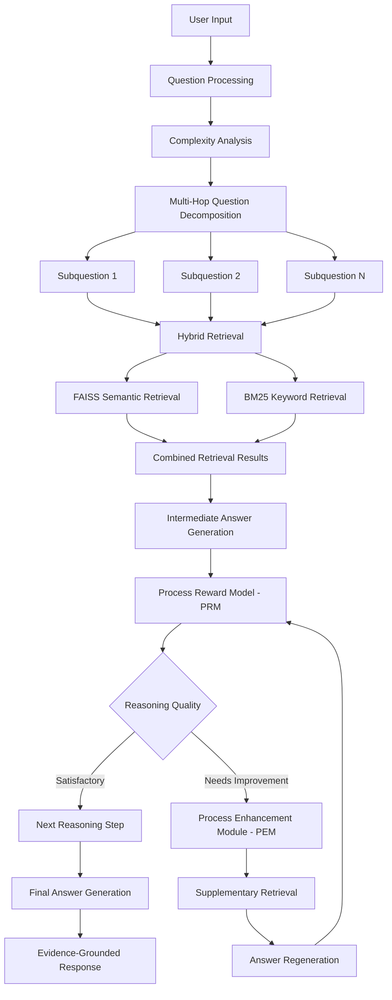
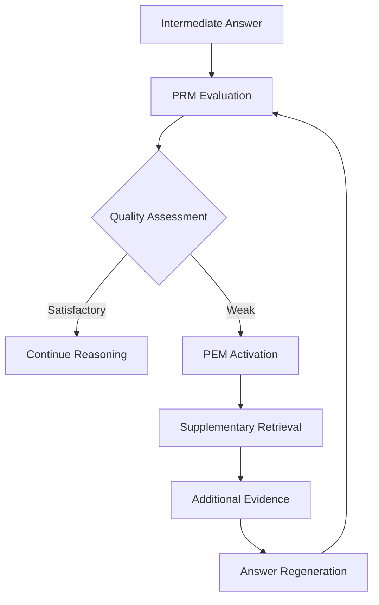

# IntelliRAG: Evidence-Grounded Multi-Hop Reasoning and Intelligent Question Answering System with Process-Reward Evaluation

<p align="center">

**An intelligent Retrieval-Augmented Generation (RAG) system designed to solve complex multi-hop questions through hybrid retrieval, evidence-grounded reasoning, and process-level answer evaluation.**

</p>

---

## 1. Overview

**IntelliRAG** is an intelligent question-answering system that addresses the limitations of conventional Retrieval-Augmented Generation (RAG) systems when handling complex questions that require multiple reasoning steps.

Traditional RAG systems generally retrieve relevant information in a single retrieval pass and generate an answer using the retrieved context. However, complex questions often require connecting information from multiple sources, identifying intermediate relationships, and reasoning across multiple stages.

IntelliRAG addresses this challenge by introducing a structured multi-hop reasoning pipeline that decomposes complex questions into smaller subquestions, retrieves relevant evidence using hybrid retrieval, generates intermediate answers, and evaluates the quality of each reasoning step.

The system integrates a **Process Reward Model (PRM)** to assess intermediate reasoning quality and a **Process Enhancement Module (PEM)** to improve weak reasoning steps through supplementary retrieval and answer regeneration.

IntelliRAG also supports evidence-grounded question answering using Wikipedia-based knowledge retrieval and uploaded PDF documents through its application interface.

### Key Objectives

- Overcome the limitations of single-pass retrieval in conventional RAG systems.
- Enable multi-hop reasoning through systematic question decomposition.
- Improve retrieval relevance using semantic and keyword-based search.
- Generate answers grounded in retrieved evidence.
- Evaluate intermediate reasoning steps instead of evaluating only the final answer.
- Improve weak reasoning steps through supplementary retrieval and regeneration.
- Support flexible answer generation using cloud-based and local language models.

---

## 2. Key Features

| Feature | Description |
|---|---|
| Multi-Hop Question Decomposition | Breaks complex questions into smaller, logically connected subquestions. |
| Hybrid Information Retrieval | Combines FAISS-based semantic retrieval with BM25 keyword retrieval. |
| Semantic Search | Retrieves contextually relevant information even when the wording differs. |
| Keyword-Based Search | Identifies documents containing important query terms. |
| Combined Retrieval | Integrates semantic and lexical retrieval results to improve evidence coverage. |
| Intermediate Answer Generation | Generates answers for individual reasoning steps using retrieved evidence. |
| Process Reward Evaluation | Evaluates intermediate answers and reasoning quality using PRM. |
| Reasoning Enhancement | Uses PEM to perform supplementary retrieval and regenerate weak answers. |
| Wikipedia-Grounded QA | Retrieves information from Wikipedia-based knowledge sources. |
| PDF Document Support | Provides a document upload interface for PDF-based question answering. |
| Flexible LLM Integration | Supports Gemini-based generation and FLAN-T5-small as a local generation fallback. |
| Evidence-Grounded Responses | Uses retrieved information as supporting context for answer generation. |

---

## 3. System Architecture

IntelliRAG follows a modular architecture consisting of question processing, multi-hop planning, hybrid retrieval, intermediate answer generation, process evaluation, and answer enhancement.

### High-Level Architecture



### Architecture Components

**1. User Input Layer**

Accepts questions through the IntelliRAG frontend. Questions may involve simple information retrieval or complex queries requiring multiple reasoning steps.

**2. Question Processing Module**

Processes the incoming question and prepares it for subsequent reasoning operations.

**3. Multi-Hop Question Decomposition**

Breaks a complex question into smaller subquestions that can be answered individually. Each subquestion represents a reasoning step required to reach the final answer.

**4. Hybrid Retrieval Module**

Retrieves relevant information using two complementary retrieval techniques:

- FAISS for semantic similarity search.
- BM25 for keyword-based relevance search.

The retrieval results are combined to provide a more comprehensive evidence set.

**5. Intermediate Answer Generation**

Generates an intermediate answer for each subquestion using the retrieved evidence and relevant information from preceding reasoning steps.

**6. Process Reward Model (PRM)**

Evaluates the quality of intermediate reasoning steps to identify weak or insufficiently supported answers.

**7. Process Enhancement Module (PEM)**

Attempts to improve weak reasoning steps by performing supplementary retrieval and regenerating the intermediate answer.

**8. Final Answer Generation**

Combines the validated intermediate reasoning results to generate a coherent response to the original question.

---

## 4. Working Methodology

IntelliRAG operates through the following stages.

### Stage 1: Question Processing

The system receives a natural-language question from the user.

It determines whether the question requires a direct answer or multiple interconnected reasoning steps.

### Stage 2: Multi-Hop Question Decomposition

Complex questions are decomposed into smaller subquestions.

For example:

**Original Question:**

"Who founded the company that developed the operating system used by the first iPhone?"

The system identifies the required reasoning steps:

1. Identify the operating system used by the first iPhone.
2. Identify the company that developed the operating system.
3. Identify the founder of that company.

Each subquestion is processed individually while maintaining the dependency between reasoning steps.

### Stage 3: Hybrid Retrieval

For every subquestion, IntelliRAG performs two retrieval operations.

**A. FAISS Semantic Retrieval**

FAISS (Facebook AI Similarity Search) performs similarity-based retrieval using vector representations of text.

The query and indexed text chunks are represented as embeddings. FAISS searches for vectors that are semantically similar to the query.

This allows the system to retrieve relevant information even when the exact query words are not present in the source text.

**B. BM25 Keyword Retrieval**

BM25 (Best Matching 25) is a probabilistic keyword-based ranking algorithm.

It evaluates the relevance of documents based on query-term frequency, inverse document frequency, and document-length normalization.

Unlike semantic retrieval, BM25 focuses on the occurrence and importance of matching keywords.

**C. Combined Retrieval**

The results from FAISS and BM25 are combined to leverage the advantages of both approaches.

- FAISS captures semantic relationships.
- BM25 captures lexical and keyword relationships.
- Combined retrieval improves the coverage of relevant evidence.

### Stage 4: Intermediate Answer Generation

The language model generates an intermediate answer for each subquestion using the retrieved evidence.

Previous intermediate answers are also considered when subsequent questions depend on earlier reasoning steps.

This enables the system to construct a connected reasoning chain instead of answering every subquestion independently.

### Stage 5: Process Reward Evaluation

The Process Reward Model (PRM) evaluates intermediate answers and their reasoning quality.

It helps identify issues such as:

- Insufficient supporting evidence.
- Incomplete reasoning.
- Weak connections between reasoning steps.
- Potentially unreliable intermediate answers.

### Stage 6: Process Enhancement

When PRM identifies a weak reasoning step, the Process Enhancement Module (PEM) attempts to improve it.

PEM performs supplementary retrieval to obtain additional relevant information and regenerates the intermediate answer.

The regenerated answer is evaluated again through PRM.

### Stage 7: Final Answer Generation

After processing the reasoning steps, the system combines the intermediate results to produce a final answer to the original question.

The objective is to provide an answer supported by retrieved evidence and connected reasoning steps.

---

## 5. PRM and PEM: Core Innovations

Two important components of IntelliRAG are the Process Reward Model and the Process Enhancement Module.

### Process Reward Model (PRM)

PRM evaluates the quality of intermediate reasoning rather than focusing exclusively on the final generated answer.

Its purpose is to identify potentially weak reasoning steps before they affect the final response.

**Main responsibilities:**

- Evaluate intermediate answers.
- Assess reasoning quality.
- Identify insufficiently supported answers.
- Provide evaluation feedback for further processing.

### Process Enhancement Module (PEM)

PEM works with the evaluation process to improve weak reasoning steps.

When an intermediate answer requires improvement, PEM attempts to retrieve additional evidence and regenerate the answer.

**Main responsibilities:**

- Identify reasoning steps requiring improvement based on evaluation feedback.
- Perform supplementary retrieval.
- Obtain additional supporting context.
- Regenerate intermediate answers.
- Send the improved answer for another evaluation.

### PRM and PEM Workflow



**Key Difference:**

PRM evaluates the reasoning quality, whereas PEM attempts to improve the reasoning when weaknesses are identified.

Together, they introduce an evaluation-and-improvement mechanism into the multi-hop RAG pipeline.

---

## 6. Technology Stack

The following technologies form the core of IntelliRAG.

| Technology | Purpose |
|---|---|
| Python | Core backend implementation and reasoning pipeline. |
| FastAPI | Backend API development and frontend communication. |
| Uvicorn | ASGI server for running the FastAPI application. |
| FAISS | Vector-based semantic retrieval. |
| BM25 | Keyword-based document retrieval. |
| Gemini API | Cloud-based language model integration. |
| FLAN-T5-small | Local language generation fallback. |
| Hugging Face Transformers | Loading and running the local language model. |
| Wikipedia | External knowledge source for grounded information retrieval. |
| PDF Processing Libraries | Extracting text from uploaded PDF documents. |
| HTML, CSS, JavaScript / Frontend Framework | User interface and frontend interactions. |

*Note: The frontend framework and individual PDF-processing dependencies should be aligned with the actual packages in the repository.*

---

## 7. Language Model Integration

IntelliRAG supports flexible language generation through cloud-based and locally executed models.

### Gemini API

Google Gemini is integrated for language generation when the API is configured.

It can be used for:

- Understanding natural-language questions.
- Generating intermediate answers.
- Supporting multi-hop reasoning.
- Producing final responses.

### FLAN-T5-small

FLAN-T5-small provides a local generation fallback.

Unlike Gemini, which requires an external API request, FLAN-T5-small runs locally using the Hugging Face Transformers framework.

This allows the application to perform answer generation without depending entirely on a cloud API key.

**Important:** FLAN-T5-small is a local fallback, not an automatic indication that Gemini is the fallback. The configured generation path determines which model is used.

---

## 8. Knowledge Sources

IntelliRAG uses evidence sources to support its question-answering process.

### Wikipedia-Based Knowledge Retrieval

Wikipedia provides an external knowledge source for answering questions across different domains.

The system retrieves relevant information from Wikipedia-based content and uses it as evidence during multi-hop reasoning.

### Uploaded PDF Documents

The frontend provides a PDF upload interface.

This enables users to interact with document-based information through the application rather than relying exclusively on general external knowledge.

---

## 9. Example Use Cases

IntelliRAG is designed for questions that require connecting information across multiple facts.

Examples include:

**Example 1: Technology**

Question: Who founded the company that developed the operating system used by the first iPhone?

Reasoning:
1. Identify the operating system used by the first iPhone.
2. Identify its developer.
3. Find the founder of the developer company.

**Example 2: Science**

Question: Which university did the scientist who discovered penicillin attend?

Reasoning:
1. Identify the scientist who discovered penicillin.
2. Retrieve the scientist's educational background.
3. Identify the university attended.

**Example 3: Geography and History**

Question: Which country was the birthplace of the founder of the organization that established the Nobel Peace Prize?

Reasoning:
1. Identify the organization responsible for awarding the Nobel Peace Prize.
2. Identify the relevant founder.
3. Retrieve the founder's birthplace.

These examples illustrate the type of interconnected information that multi-hop reasoning is intended to handle.

---

## 10. Project Structure

The repository is organized into separate backend and frontend components.

```text
IntelliRAG/
│
├── backend/
│   ├── main.py
│   ├── requirements.txt
│   ├── [Backend modules and supporting files]
│   └── [Configuration and processing modules]
│
├── frontend/
│   ├── [Frontend application files]
│   ├── [Components]
│   ├── [Stylesheets]
│   └── [Frontend configuration]
│
├── README.md
└── .gitignore
```

The backend handles the question-answering pipeline, retrieval operations, model integration, and API communication.

The frontend provides the user interface for submitting questions and interacting with the system.

*The tree above is a high-level representation. Consult the repository for the exact files and module names.*

---

## 11. Installation and Setup

### Prerequisites

Ensure the following software is installed:

- Python 3.11
- Node.js and npm
- Git
- pip
- A code editor such as Visual Studio Code

### Step 1: Clone the Repository

```bash
git clone https://github.com/VaishnaviChiluvuri/IntelliRAG.git

cd IntelliRAG
```

### Step 2: Set Up the Backend

Navigate to the backend directory:

```bash
cd backend
```

Create a virtual environment:

```bash
python -m venv venv
```

Activate the environment.

**Windows:**

```bash
venv\Scripts\activate
```

**Linux / macOS:**

```bash
source venv/bin/activate
```

Install the required dependencies:

```bash
pip install -r requirements.txt
```

### Step 3: Configure API Credentials

Configure the Gemini API key and Hugging Face token if required by the selected model and retrieval configuration.

Create or update the appropriate `.env` file according to the backend configuration.

Example:

```env
GEMINI_API_KEY=your_gemini_api_key
HF_TOKEN=your_huggingface_token
```

Never commit API keys, access tokens, or other credentials to GitHub.

### Step 4: Start the Backend

From the project root, execute:

```bash
python -m uvicorn main:app --app-dir backend --host 127.0.0.1 --port 8000 --reload
```

The backend should start on:

```text
http://127.0.0.1:8000
```

If the port is already in use, stop the existing process or select another available port and update the frontend API configuration accordingly.

### Step 5: Set Up the Frontend

Open a separate terminal and navigate to the frontend directory:

```bash
cd frontend
```

Install frontend dependencies:

```bash
npm install
```

Start the frontend using the development script configured in `package.json`:

```bash
npm run dev
```

### Step 6: Access IntelliRAG

Open the local frontend URL displayed in the terminal.

You can now interact with IntelliRAG through its user interface.

---

## 12. Environment Configuration

The application may require environment variables depending on the selected generation and retrieval configuration.

| Variable | Description |
|---|---|
| `GEMINI_API_KEY` | API key for Google Gemini integration. |
| `HF_TOKEN` | Hugging Face access token where required. |

Keep credentials in environment files and ensure those files are excluded from version control.

---

## 13. Advantages of IntelliRAG

1. **Multi-Hop Reasoning:** Handles questions that require multiple interconnected reasoning steps.

2. **Hybrid Retrieval:** Combines semantic and keyword-based retrieval to improve evidence coverage.

3. **Intermediate Evaluation:** Evaluates reasoning steps rather than depending solely on the final answer.

4. **Reasoning Enhancement:** Attempts to improve weak answers through supplementary retrieval and regeneration.

5. **Flexible Generation:** Supports cloud-based generation and a local generation fallback.

6. **Knowledge Grounding:** Uses retrieved information to support generated answers.

7. **Modular Architecture:** Separates frontend interactions, backend processing, retrieval, and answer generation.

8. **Extensibility:** Provides a foundation for incorporating additional retrieval strategies, knowledge sources, and evaluation mechanisms.

---

## 14. Limitations

Like other retrieval-augmented question-answering systems, IntelliRAG has certain limitations:

- Answer quality depends on the relevance and completeness of retrieved evidence.
- Incorrect question decomposition can affect subsequent reasoning steps.
- Hybrid retrieval may still miss relevant information.
- Language model outputs may contain inaccuracies despite evidence retrieval and evaluation.
- The quality of local generation can differ from cloud-based generation.
- External knowledge sources may have incomplete or outdated information.
- Repeated retrieval and regeneration can increase response time.

---

## 15. Future Enhancements

Potential improvements to IntelliRAG include:

- Advanced reranking techniques for better retrieval precision.
- More comprehensive reasoning evaluation.
- Improved handling of contradictory evidence.
- Support for additional document formats such as DOCX and TXT.
- Expanded knowledge-source integration.
- Retrieval and reasoning performance optimization.
- More detailed source citations and evidence visualization.
- Quantitative evaluation using established multi-hop question-answering datasets.
- Improved confidence estimation and answer verification.

---

## 16. Research Significance

IntelliRAG explores an important direction in Retrieval-Augmented Generation: improving the reliability of complex question answering through structured reasoning and process-level evaluation.

Rather than treating retrieval and generation as a single operation, the system introduces multiple reasoning stages, hybrid evidence retrieval, intermediate answer evaluation, and an enhancement mechanism.

The integration of PRM and PEM provides an additional layer of quality control by identifying and attempting to correct weaknesses during the reasoning process.

This approach aims to make multi-hop question answering more structured, evidence-aware, and reliable.

---

## 17. Team

**Project:** IntelliRAG

**Project Title:** IntelliRAG: An Evidence-Grounded Multi-Hop Reasoning and Intelligent Question Answering System with Process-Reward Evaluation

**Institution:** VIT-AP University

**Department:** Computer Science and Engineering

**Specialization:** Artificial Intelligence and Machine Learning

### Project Team

| Team Member | Registration Number |
|---|---|
| Kosaraju Sarvani | 23BCE9680 |
| Chiluvuri Sai Sri Vaishnavi | 23BCE9684 |
| Bandreddi Yasasri Madhavi | 23BCE8658 |
| Panidapu Meghana | 23BCE |

---

## 18. Acknowledgements

We would like to acknowledge the faculty members and project guide at VIT-AP University for their guidance and support throughout the development of IntelliRAG.

We also acknowledge the developers and research communities behind FAISS, Hugging Face Transformers, Google Gemini, and other open-source technologies that contributed to the development of this project.

---

## 19. Repository

**GitHub:** https://github.com/VaishnaviChiluvuri/IntelliRAG

---

## 20. License

The licensing terms of this project should be specified by the repository owners. No license is assumed unless a corresponding LICENSE file is included in the repository.
